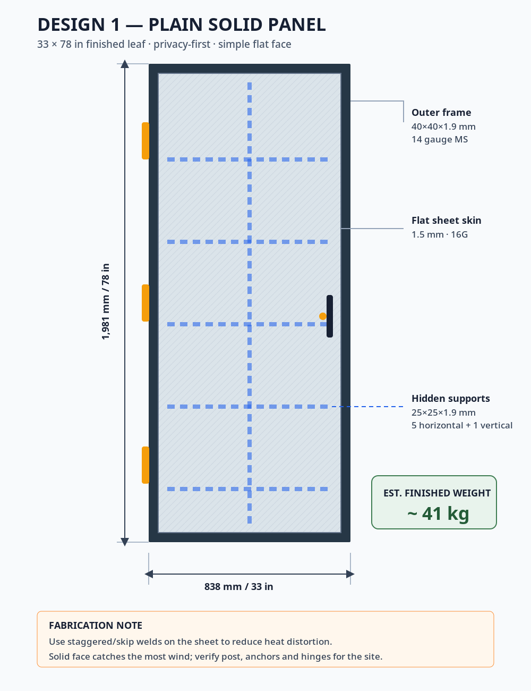
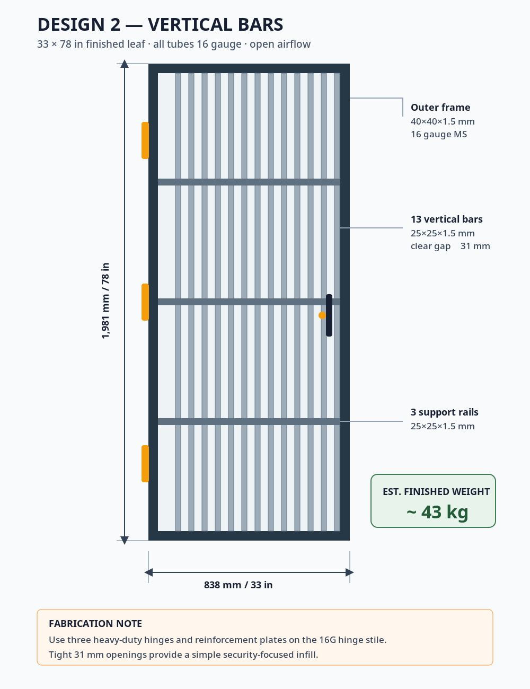
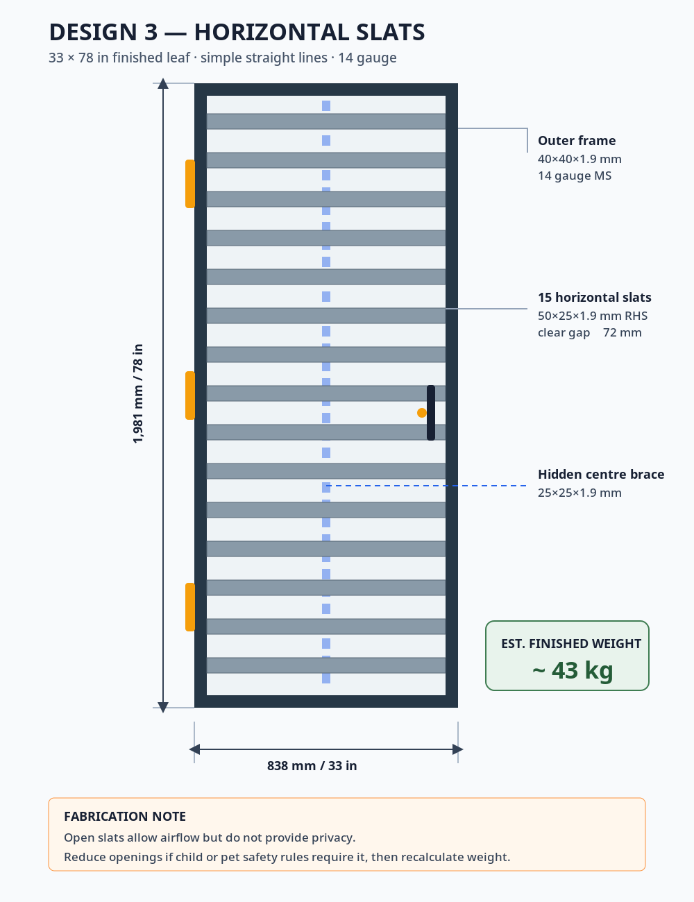
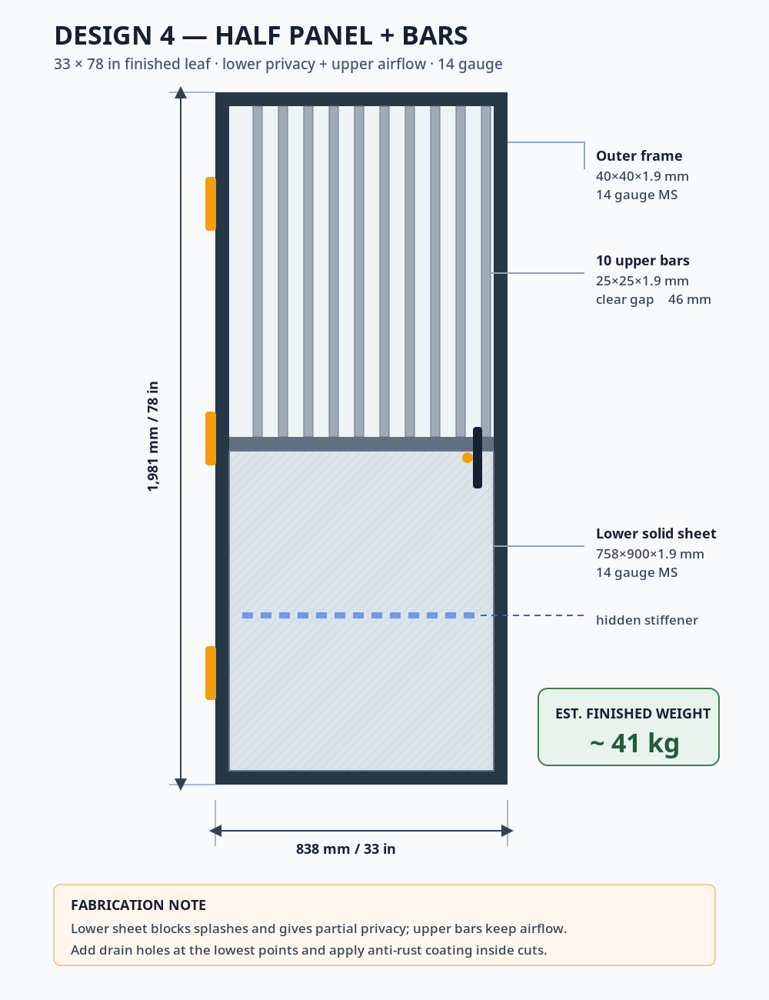
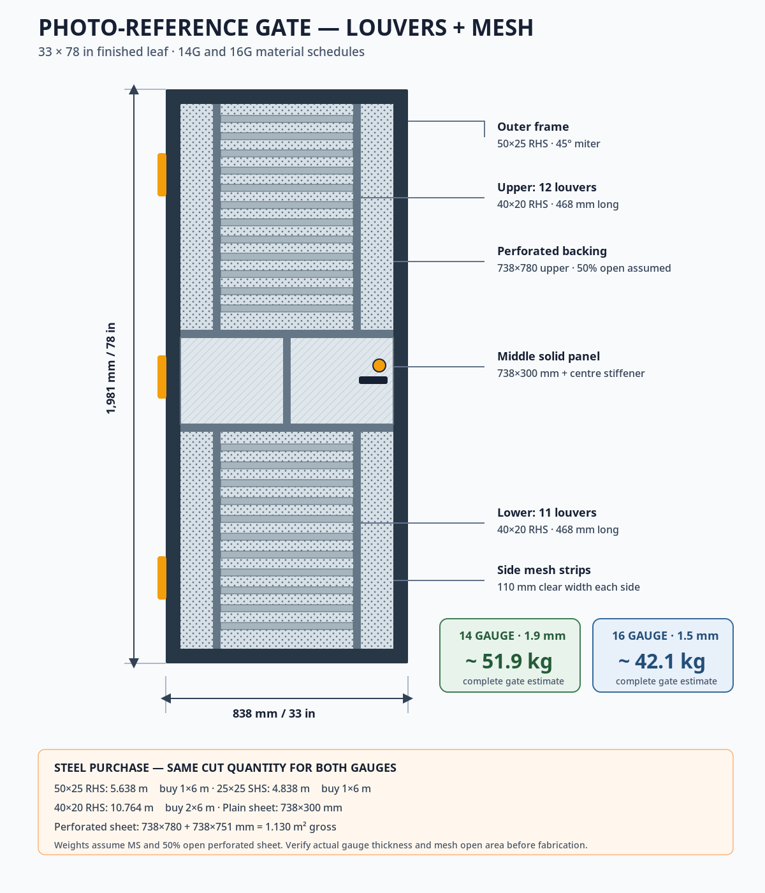

# 33 × 78 inch Simple Steel Gate Designs

यह repository **33 inch चौड़े × 78 inch ऊँचे gate leaf** के चार simple designs देती है। सभी designs का अनुमानित finished weight **40–60 kg** के बीच रखा गया है।

> **Material assumption:** आपने aluminium और steel दोनों लिखा था। `14 gauge`/`16 gauge` आम तौर पर mild-steel sheet/tube के लिए बोला जाता है, इसलिए ये drawings **mild steel (MS)** के लिए बनाई गई हैं। Aluminium में यही sections काफी हल्के होंगे और 40–60 kg target स्वाभाविक रूप से नहीं मिलेगा।

## Design gallery

| Design | Preview | Main material | Estimated weight |
|---|---|---|---:|
| 1. Plain solid panel |  | 14G frame + 16G sheet | **≈ 41 kg** |
| 2. Vertical bars |  | 16G tubes | **≈ 43 kg** |
| 3. Horizontal slats |  | 14G tubes | **≈ 43 kg** |
| 4. Half sheet + bars |  | 14G tubes/sheet | **≈ 41 kg** |

## Common finished size

- Gate leaf: **838 mm × 1,981 mm** (33 × 78 inch)
- Drawing dimensions finished outer leaf की हैं, wall opening की नहीं।
- अगर masonry opening 33 × 78 inch है, fabricator को hinge, latch और floor clearance घटाकर leaf size तय करना होगा। आम starting allowance: hinge side **6–10 mm**, latch side **4–6 mm**, top **4–6 mm**, bottom **8–12 mm**। Actual hardware/site level के अनुसार बदलें।
- Steel density used for estimates: **7,850 kg/m³**
- Typical thickness used: **14G ≈ 1.9 mm**, **16G ≈ 1.5 mm**. खरीदने से पहले supplier से actual measured thickness पूछें, क्योंकि local gauge tables बदल सकती हैं।
- Weight में लगभग **3 kg** hinges, latch/lock plate, weld metal और small fittings के लिए शामिल हैं। Paint/galvanizing के कारण थोड़ा फर्क आएगा। Practical tolerance **±10%** मानें।

## Design 1: Plain solid panel, privacy-first

**Images:** [`PNG`](designs/design-1-solid-panel.png) · [`SVG`](designs/design-1-solid-panel.svg)

- Outer frame: 40 × 40 × 1.9 mm MS square tube, 14G
- Skin: 758 × 1,901 × 1.5 mm MS sheet, 16G
- Hidden supports: 25 × 25 × 1.9 mm, five horizontal + one vertical
- Estimated calculation: frame 12.8 + sheet 17.0 + supports 7.8 + fittings 3.0 = **40.6 kg**
- फायदा: पूरी privacy, बहुत simple flat look।
- ध्यान: sheet को continuous weld न करें; staggered/skip weld और clamping से heat distortion कम करें। नीचे drain/weep holes रखें।

## Design 2: Vertical bars, 16-gauge option

**Images:** [`PNG`](designs/design-2-vertical-bars.png) · [`SVG`](designs/design-2-vertical-bars.svg)

- Outer frame: 40 × 40 × 1.5 mm MS square tube, 16G
- Infill: 13 vertical bars, 25 × 25 × 1.5 mm MS tube, 16G
- Supports: three horizontal rails, 25 × 25 × 1.5 mm, 16G
- Clear gap between bars: लगभग **31 mm**
- Estimated calculation: frame 10.2 + bars 27.3 + rails 2.5 + fittings 3.0 = **43.1 kg**
- फायदा: ventilation और visibility, साफ तथा मजबूत appearance।
- ध्यान: 16G hinge-side stile पर three hinges और local reinforcement plates रखें।

## Design 3: Horizontal slats

**Images:** [`PNG`](designs/design-3-horizontal-slats.png) · [`SVG`](designs/design-3-horizontal-slats.svg)

- Outer frame: 40 × 40 × 1.9 mm MS square tube, 14G
- Slats: 15 pieces, 50 × 25 × 1.9 mm rectangular MS tube, 14G
- Hidden centre brace: 25 × 25 × 1.9 mm, 14G
- Vertical clear gap: लगभग **72 mm**
- Estimated calculation: frame 12.8 + slats 24.2 + brace 2.6 + fittings 3.0 = **42.6 kg**
- फायदा: सीधी modern lines, फिर भी fabrication simple है।
- ध्यान: 72 mm gaps privacy नहीं देते। छोटे बच्चे/pets हों तो gap site requirement के अनुसार कम करें; weight फिर calculate करें।

## Design 4: Half sheet + upper bars

**Images:** [`PNG`](designs/design-4-half-panel.png) · [`SVG`](designs/design-4-half-panel.svg)

- Outer frame: 40 × 40 × 1.9 mm MS square tube, 14G
- Lower sheet: 758 × 900 × 1.9 mm MS sheet, 14G
- Upper infill: 10 vertical bars, 25 × 25 × 1.9 mm, 14G
- Divider + lower hidden stiffener: 25 × 25 × 1.9 mm, 14G
- Upper clear gap: लगभग **46 mm**
- Estimated calculation: frame 12.8 + lower sheet 10.2 + bars 12.4 + rails 2.1 + fittings 3.0 = **40.5 kg**
- फायदा: नीचे privacy/splash protection और ऊपर airflow।
- ध्यान: lower sheet के bottom पर पानी जमा न हो; weep holes और anti-rust coating दें।

## Fabrication and safety notes

1. **Three heavy-duty hinges** लगाएँ। Combined rated capacity gate weight से कम से कम 2×, यानी **100 kg या अधिक**, रखें। Hinge rating और mounting method manufacturer से verify करें।
2. Hinge और lock locations पर **3 mm reinforcement plates** दें। Plates का weight 3 kg fittings allowance में माना गया है।
3. Frame diagonals weld करने से पहले दोनों corner-to-corner dimensions बराबर करके squareness check करें।
4. Outdoor gate पर zinc-rich primer + exterior top coat या hot-dip galvanizing रखें। Tube ends cap करें, लेकिन lowest points पर drain holes दें।
5. Post/wall anchors, hinge type, wind load और weld size site engineer/fabricator तय करे। Solid-panel design पर हवा का load सबसे अधिक होगा।
6. Fabrication शुरू करने से पहले actual opening को top/middle/bottom और दोनों diagonals पर नापें।

## Recommendation

- पूरी privacy चाहिए: **Design 1**
- 16G में हल्का-looking लेकिन 40 kg से अधिक gate चाहिए: **Design 2**
- simple modern style चाहिए: **Design 3**
- privacy + हवा दोनों चाहिए: **Design 4**

ये concept/fabrication drawings हैं, stamped structural drawings नहीं। Site condition और local safety rules के अनुसार qualified fabricator/engineer final sections, anchors और welds verify करे।

## Photo-reference design: louvers + mesh + middle panel

आपकी भेजी हुई gate photo के pattern पर अलग fabrication drawing और complete material schedule जोड़ा गया है। यह भी **838 × 1,981 mm (33 × 78 inch) finished leaf** पर आधारित है।

- **14G complete gate:** लगभग **51.9 kg**
- **16G complete gate:** लगभग **42.1 kg**
- Exact tube requirement: **21.240 m**
- Practical purchase: **50×25 की 1 × 6 m, 25×25 की 1 × 6 m, 40×20 की 2 × 6 m lengths**
- Plain sheet: **738 × 300 mm**
- Perforated sheet: **1.130 m² gross**

पूरी cutting list, purchase quantity, component-wise weight और fabrication notes:

- [`Complete material details`](photo-reference/MATERIAL-DETAILS.md)
- [`14-gauge BOM CSV`](photo-reference/bom-14-gauge.csv)
- [`16-gauge BOM CSV`](photo-reference/bom-16-gauge.csv)
- [`Editable SVG drawing`](photo-reference/photo-reference-louver-gate.svg)
